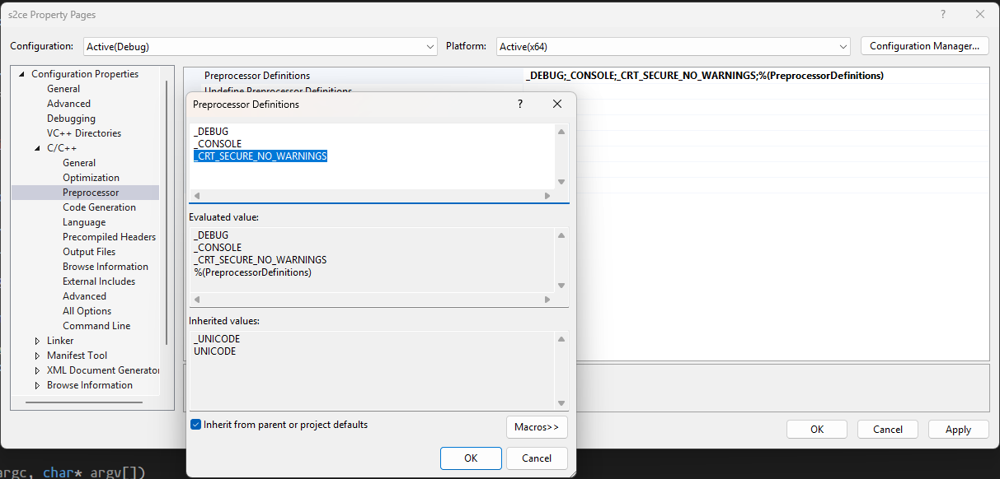

Put build of this source in the root `sai2.exe` directory with `s2ce.dll` provided by [s2cedll](https://github.com/supchyan/s2cedll) repo. Launch injector executable to start sai2 with modified theme.

### Potential exception _CRT_SECURE_NO_WARNINGS
Add `_CRT_SECURE_NO_WARNINGS` in Preprocessor settings:
